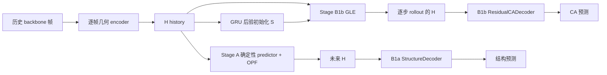

**蛋白质动力学框架：代码现状、阻断问题与下一步计划**

审查日期：2026-10-17。代码基线：`7857ba6d31c70ed82f625ecc29080879b9478341`。依据 `REVIEWER_BRIEF.md` 阅读实际数据、模型、训练、评估代码，并检查本机已有 artifacts。下文将当前代码事实、旧实验产物和研究假说分开；运行中的 `checkpoint_latest.pt` 只是某一时刻的快照。

**结论：Stage A 学表示、Stage B 用记忆状态补足非 Markov 动力学，这条研究路线可以继续；当前实现与实验尚不足以判断 H+S 是否优于 pure JEPA。下一轮的最高优先级是修复时间轴、梯度、表示交接与评估，再验收 H，最后评估 S 的增量收益。仅统一窗口后继续扩大训练，仍会遇到已确认的实现断点。**

**1．先把目标定义为可以验证的任务**

建议将目标写成：给定序列、温度和历史 backbone 轨迹，预测未来构象的条件分布，并生成时间上连贯的轨迹：

`p(X_{t+τ} | X_{t-K+1:t}, sequence, temperature)`。

这里有三个需要区分的能力：

- **短期预测：** 在可预测时间范围内，未来结构或 observable 的点预测优于 persistence。
- **条件生成：** 对不可唯一确定的未来给出经过校准的构象样本分布。
- **动力学生成：** 长程轨迹具有合理的接触、torsion、RMSF、MSD、时间相关与转移统计，并保持几何有效。

目前 backbone 坐标没有完整的速度、侧链和溶剂状态。即使模型完美，也不能保证从有限 history 精确复现任意长时间后的唯一 MD 帧。合理的产品能力是“可查询 τ 的未来分布/样本”，并明确经过验证的时间范围、采样间隔与输出原子范围。

当前 `H_t = E(X_t)` 是**单帧表示**，不是 history encoder 输出。同一个构象、两段不同到达历史，会得到相同的 deterministic H；这本身合理。H 应保留当前几何和与演化有关的构象信息，历史中额外可预测的信息由 S 的后验承担。对单帧 H 的要求应是“可读出、动态敏感、利于预测”，而不是“包含不可观测的完整微观动力学状态”。

**2．当前代码实际上实现到了哪里**



图中的两条解码通路目前不同，且训练/推理的 H 来源尚未可靠锁定，不能把两条通路的差异全部解释为 S 的贡献。

| 模块 | 实际实现 | 与目标的距离 |
|---|---|---|
| 数据 | mdCATH/NPZ 读取、paired windows、mask、collate | A、B、eval 没有共用一个实际生效的时间合同；B1b 存在训练泄漏 |
| Encoder | SE(3) 不变的逐帧残基 attention；几何、距离、可选方向特征和身份 embedding | 没有时间交互；H 是否保留可解码动态信息须单独验收 |
| Stage A | online/EMA encoder、OPF、多 lag 确定性 factor-delta 预测、空间 mask、方差/contrast 与距离重建辅助项 | 不是单一 JEPA loss；空间 query、dropout 和 OPF 条件数有实际问题 |
| B1a | StructureDecoder、物理 probe、normalizer，可配置 encoder 顶层解冻 | 默认路径已变成预测 H→结构，而非 true-H oracle；默认 detach 使解冻无效 |
| B1b | 标量能量 U、`f=-∇U`、历史 GRU 后验、H/S Euler–Maruyama、Kalman NLL、ES 和独立 residual decoder | 数学局部实现已有测试；端到端时间轴、梯度和交接不成立 |
| B2 | bath-aware decoder 与 autonomous helper | 没有独立 B2 训练入口；设计中的随机 direct generator 尚未完整交付 |
| Stage C | OpenFold 几何、结构 decoder 和 objective 库 | 是复用的结构组件；生成 atom37 不代表学到了侧链动力学 |
| Evaluation | loaders、variants、窗口、Kabsch、聚合与报告 | Kabsch 核心正确，但主指标合同、配对统计、oracle 和版本适配需要修复 |

实际入口主要是 [Stage A trainer](/liuyutian/protein_jepa_frame/protein_jepa_frame/training/train_stage_a_v2.py)、[B1a trainer](/liuyutian/protein_jepa_frame/protein_jepa_frame/training/train_stage_b1a.py)、[B1b trainer](/liuyutian/protein_jepa_frame/protein_jepa_frame/training/train_stage_b1b.py) 和 [evaluation runner](/liuyutian/protein_jepa_frame/evaluation/run_eval.py)。`STAGE_AB_REDESIGN_PLAN.md` 是设计目标，不能视为这些入口已经实现的功能清单。

B1b 实际的共演化核为：`f=-∇_H U(H;T)`；`H'=H+hDf+hCS+√(2hD)ε_H`；`S'=S+h(Cᵀf−ΓS)+√(2hΓ)ε_S`。历史 GRU 输出每残基的 `S₀~N(m₀,P₀)`，当前主配置 `dH=128,dS=8,h=1000 ps`。连续模型有合理的记忆浴动机，但有限步长的稳定性、投影后 H 的统计以及条件分布质量仍须实验验证。当前 autonomous 按整数个 h 查询；Stage A direct 虽接受数值 τ，也没有因此获得任意 τ 的准确性或跨 τ 的路径一致性保证。

**3．必须先修复的代码问题**

**3.1 B1b 的训练 history 会包含被评分的未来帧，且后验时点不统一。P0。**

位置：[train_stage_b1b.py:211](/liuyutian/protein_jepa_frame/protein_jepa_frame/training/train_stage_b1b.py:211)、[train_stage_b1b.py:272](/liuyutian/protein_jepa_frame/protein_jepa_frame/training/train_stage_b1b.py:272)。

`history_frames=8, horizon_steps=8` 时，trainer 将 `total=17` 同时用作 paired clip 长度和保留的 context 长度；实际 history 是 **17 帧**。DataConfig 还继承默认 paired horizons `(8,16,24,48)`。使用实际 synthetic dataset 和实际 collate 得到：

| paired horizon | posterior 看见的 history | NLL 的 H 序列 | 问题 |
|---:|---|---|---|
| 8 | `[0..16]` | `[8..16]` | 被评分的 `[9..16]` 全部已经进入 history |
| 16 | `[0..16]` | `[16..24]` | 时间相接，但 history 仍是 17 帧而非声明的 8 帧 |
| 24 | `[0..16]` | `[24..32]` | posterior 对应时点与 rollout 初态间有空档，未传播 S |
| 48 | `[0..16]` | `[48..56]` | 同上 |

这是训练条件泄漏与时间索引错误，不是“模型可能没用到历史”的假说。修复时应直接采样一条连续片段，显式构造 `history=[t-K+1..t]`、`H_seq=[t..t+N]`；唯一允许的共享帧是 anchor t。断言 `max(history_time)==H_seq_time[0]`、所有评分帧严格晚于 history，且每步真实间隔与 kernel 的 h 一致。

**3.2 B1a 默认分支的 encoder 微调没有梯度。P0。**

位置：[train_stage_b1a.py:264](/liuyutian/protein_jepa_frame/protein_jepa_frame/training/train_stage_b1a.py:264)、[train_stage_b1a.py:397](/liuyutian/protein_jepa_frame/protein_jepa_frame/training/train_stage_b1a.py:397)。

`--use-predicted-h` 默认开启；`_predict_future_h()` 在 `torch.no_grad()` 中执行 encoder、predictor、OPF，最后再次 `detach()`。后续结构、physical probe 和 anchor loss 都接收这个无梯度 H。`--unfreeze-top-n-blocks 2` 只是把参数放进 optimizer，不能恢复计算图。

CPU 小实验：预测 H 的 `requires_grad=False`，反传后 **encoder 获得梯度的参数数为 0**。因此不能把当前 unified B1a 脚本称作有效的 encoder 表示校准。

应拆成两个明确模式：① **true-H oracle/calibration**，输入真实目标帧编码，验收并按需微调 encoder；② **predicted-H adaptation**，解决未来预测 H 的分布偏差。第二种可以在第一种通过后做，不能替代第一种，也不能继续把其 decoder 当未经限定的 representation oracle。

**3.3 A→B1a→B1b→eval 的表示交接不一致。P0。**

位置：[train_stage_b1b.py:148](/liuyutian/protein_jepa_frame/protein_jepa_frame/training/train_stage_b1b.py:148)、[train_stage_b1b.py:165](/liuyutian/protein_jepa_frame/protein_jepa_frame/training/train_stage_b1b.py:165)、[loaders.py:92](/liuyutian/protein_jepa_frame/evaluation/loaders.py:92)、[loaders.py:394](/liuyutian/protein_jepa_frame/evaluation/loaders.py:394)。

- B1b 从 Stage A checkpoint 取 encoder，只从 B1a 取 normalizer；**不接收 B1a 微调 encoder，也不继承 B1a decoder**。即使 B1a 微调修好，这个交接仍会丢失微调结果。
- 当前 B1b `encode_frames()` 会应用传入的 B1a normalizer；eval 的 `encode()` 默认 raw H，`variants.encode_clip()` 没有覆盖这个默认值。unified B1b 明确传了 B1a checkpoint；训练与评估未显式共享 normalization 合同，normalizer 含非平凡统计量时将产生尺度错配。
- **历史限定：** 旧 mdCATH/mixed B1b 的配置是 `b1a_ckpt=null`，当时为 Identity normalization；不能把上述新路径的尺度问题反推为所有旧结果的原因。
- 旧 smoke 的 h+s 使用 B1a encoder，而其 B1b 训练配置记录 Stage A mixed encoder。除了跨 variants 的混淆，单个 rollout 的输入也不符合它训练时的表示基底。
- 对旧 predictor，legacy 实现曾以 `delta_target=False` 表示 absolute factor，而 eval adapter 无条件加 anchor factor。当前 multilag 已改成 always-delta。必须记录 **output_contract** 并按版本加载，不能只看今天的同名 flag 解释过去的 checkpoint。

应交付一个不可分割的 `RepresentationBundle`：encoder 权重、训练/eval 模式、raw/normalized 约定、normalizer、OPF 与 predictor 输出语义、decoder、schema 和各自 hash。加载不匹配应直接失败，不能靠注释或 `strict=False` 继续混接。B1a 若改变 encoder，原 Stage A predictor 也必须重训/适配后再比较。

**3.4 B1b 的“结构监督+多步分布监督”没有完整训练到动力学核。P0。**

位置：[train_stage_b1b.py:373](/liuyutian/protein_jepa_frame/protein_jepa_frame/training/train_stage_b1b.py:373)、[model.py:384](/liuyutian/protein_jepa_frame/protein_jepa_frame/models/stage_b1b/model.py:384)。

- `_rmsd_term()` 接收冻结 encoder 编出的 **真实未来 H**，只训练新建的 ResidualCADecoder。它没有调用动力学预测 H；CPU 反传检查：**动力学有梯度参数 0，decoder 有梯度参数 6**。它是 oracle decoder 训练，不是端到端动力学 RMSD 监督。
- `rollout(detach=False)` 虽保留部分图，但 `sample_step()` 始终 `compute_forces(create_graph=False)`。ES 不能对 U 的参数或力对 H 的导数反传。CPU 实测 ES 反传：**energy 参数梯度数 0**，bath 和 posterior 分别为 18、8。
- 现在能量仍可由 NLL 训练；不能把问题误说成整个 B1b 完全没有训练。准确问题是：多步目标无法按设计校正能量力，物理结构误差也没有校正 rollout。

修复后应对各 loss 分别记录 encoder / predictor / energy / bath / posterior / decoder 的梯度范数；要验收可微 rollout，通过固定 decoder 或固定物理 observable Φ 对**预测 H**评分。不要让 decoder 自由适配来掩盖 H 漂移。

**3.5 ResidualCADecoder 不满足旋转等变性。P0。**

位置：[residual_decoder.py:77](/liuyutian/protein_jepa_frame/protein_jepa_frame/models/stage_b1b/residual_decoder.py:77)。

输入 H 为旋转不变量；MLP 从这些不变量输出三维 `dx`，直接执行 `X_anchor + dx`，没有局部基或等变向量。旋转 anchor 后 H、dx 不变，因此输出不能随输入一起旋转。

小实验旋转 90° 后，`dx` 完全相同；等变误差约为 dx 范数的 **0.773 倍**。初始化位移很小，所以绝对误差约 `0.00185 Å`，这不代表学到大位移后仍只有这个误差。

应改成合法的局部帧位移 `dx_global=R_anchor·dx_local` 或等变 decoder，并在同样规范下监督。零残差等于 persistence 是有用的起点，但**不能推出训练后的预测只会变好、不可能更差**。

**3.6 评估的配对统计和指标合同不成立。P0。**

位置：[run_eval.py:158](/liuyutian/protein_jepa_frame/evaluation/run_eval.py:158)、[metrics.py:65](/liuyutian/protein_jepa_frame/evaluation/metrics.py:65)、[metrics.py:97](/liuyutian/protein_jepa_frame/evaluation/metrics.py:97)。

- **Kabsch 算法本身通过了独立检查。** 但 runner 对每个 prediction 分别与 target 拟合 R，而 spec 要求从真实 anchor→target 计算一次公共 R,t，再应用到 prediction。两者回答不同问题；普通 aligned RMSD 可以保留为形状指标，但不能冒充文档约定的 anchor 位移误差。已有 `anchor_align_rotation()` 并未被 runner 调用。
- `PerProteinRow` 实际每个 anchor/window 一行，直接对相关窗口计算 SEM/CI，未先按 protein 聚合。
- persistence 的配对 key 只有 `protein_id+trajectory_id`，同轨迹多个 anchor 被最后一个覆盖；该轨迹全部预测都与最后一个 anchor 的 persistence 比较。
- 最小反例：同一轨迹的 persistence 值 `[1,3]`，persistence 与自身比较，真实 paired Δ 应严格为 0；当前函数输出 CI 的均值 **−1.0 Å**。因此现有报告的 `sig?` 不可用于结论。
- oracle 只按一个 `rep_variant`（通常 h_ft）计算，然后附到所有 variants；h+s 自己的 residual decoder 没有对应 true-H control。
- h+s 多个样本先取坐标均值再算 RMSD，MSD 却是逐样本 MSD 的平均。前者评价 ensemble mean，后者评价各样本相对 anchor 的运动幅度，包含均值运动与样本方差；两者不是同一个预测对象，没有完整评价条件分布或单条轨迹。

修复：记录完整 window key `(protein,T,replica,anchor,target,τ,model_rep)`；按相同 window 精确配对，先汇总同 protein 内的 anchors/replicas，再按 protein 做 cluster bootstrap。点预测、逐样本分数、分布分数分开报告；每个 encoder/decoder 分别测其 oracle。

另一个独立阻断：[run_gate.py:81](/liuyutian/protein_jepa_frame/evaluation/run_gate.py:81) 只把 anchor 与 τ 后目标拼成两帧，却按单个固定 1 ns kernel 算 NLL，默认 τ=4 ns；分母又乘了 4，而 persistence 按真实的一次 transition 归一化。现有 NLL gate 不能支持 likelihood 优势。

**3.7 Stage A 的空间掩码 query 无法区分被遮住的残基。P0。**

位置：[encoder.py:264](/liuyutian/protein_jepa_frame/protein_jepa_frame/models/encoder.py:264)、[model.py:679](/liuyutian/protein_jepa_frame/protein_jepa_frame/models/stage_a_v2/model.py:679)、[model.py:175](/liuyutian/protein_jepa_frame/protein_jepa_frame/models/stage_a_v2/model.py:175)。

masked residue 的 H 全部置零，随后直接送给 predictor。predictor 只有帧位置编码，没有区分各 masked residue 的 query 身份。对同一个蛋白，所有 masked query 相同，空间 attention 也无法区分它们。

CPU probe：遮住残基 `[2,4,7]`，三个 `pred_factors` 的最大差异 **0.0**，teacher targets 却不同。实际 unified checkpoint 上也存在这个结构性对称性。dropout 产生随机差异不能补回残基身份。

修复：给 masked queries 提供不泄露几何的 residue index / chain / aatype / mask embedding；继续屏蔽目标坐标与由其派生的可见边信息。加入“不同 masked query 能根据合法身份得到不同输出”的测试。

**3.8 动态正则能被 dropout 噪声满足；OPF 合成存在实测病态。P1，但应在下一轮 A 训练前处理。**

动态 loss 使用 train-mode online H：[objectives.py:443](/liuyutian/protein_jepa_frame/protein_jepa_frame/models/stage_a_v2/objectives.py:443)。把同一结构复制四帧，随机初始化 encoder 的相邻 H RMS 差约 **0.182**，eval 模式约为 0；unified step 2000 checkpoint 上 train 模式约 **0.312**、eval 模式 0。训练的 temporal floor 只有 **0.10**。

这证明 floor 可以被独立 dropout 满足，不能把 `temporal_variance=0` 当作真实时间信息通过验收。应在 deterministic、仍可求导的分支计算动态约束，或明确控制共享 dropout；全部动态诊断用 eval-mode 表示。这个 probe **不等价于已经证明真实 MD 的 H 全部塌缩**。

OPF 当前 compose 使用 pseudoinverse，本身没有“错误地用转置代替逆”的问题。但实际 unified step 2000 checkpoint 的 analysis matrix 测得：最小奇异值约 `1.13e-4`、最大 `1.343`、condition number **约 1.19e4**。某些方向的 factor 小误差可能被放大约 8800 倍。仅 factor MSE 很小不足以保证合成 H 准确。

应监控 `σ_min/σ_max/condition number`、factor error 与 compose 后 H error，先比较固定正交 P、受约束正交 P 与无 OPF。条件良好的可逆坐标变换本身不会增加信息，OPF 的收益必须通过同预算消融证明。

本次 OPF 测量对应 checkpoint SHA256：`1b5304eb9d51dbd4d6bd6a53e7eed18c93aabba311964d107a77f0367d476349`，step=2000。探针与输出保存在 `artifacts/review_20261017/`；后续读取同一个 latest 路径可能得到不同 step，不应要求其数值逐字相同。

**4．其它会妨碍复现或扩大实验的问题**

- `delta_target` 已不控制当前 temporal 目标；`ema_warmup_steps` 保存后被 trainer 显式传入的 momentum schedule 绕过。配置需要打印实际生效语义，而非只记录传入值。参见 [Stage A target](/liuyutian/protein_jepa_frame/protein_jepa_frame/models/stage_a_v2/model.py:938)、[EMA 更新](/liuyutian/protein_jepa_frame/protein_jepa_frame/training/train_stage_a_v2.py:457)。
- Stage A 日志里的 `total` 来自 `comp.total`，没有包含之后加入的 `struct_recon_weight*recon`；B1b 记录的 total 同样未包含外加 RMSD。日志 total 不能直接理解为反传的完整目标。参见 [A loss 与日志](/liuyutian/protein_jepa_frame/protein_jepa_frame/training/train_stage_a_v2.py:428)、[B loss 与日志](/liuyutian/protein_jepa_frame/protein_jepa_frame/training/train_stage_b1b.py:333)。
- B1b 的 NLL 分母缺少 dH，而 loss 合同要求 per-dimension。dH=128 时，NLL 相对 ES/RMSD 的权重相差 128 倍；NLL-only 的最优点不因此改变，混合目标的权衡会改变。参见 [分母](/liuyutian/protein_jepa_frame/protein_jepa_frame/training/train_stage_b1b.py:307)。
- B1b resume 恢复 model/optimizer，却没有恢复其保存的 residual decoder；继续训练时 decoder 权重和 optimizer state 不对应。参见 [resume](/liuyutian/protein_jepa_frame/protein_jepa_frame/training/train_stage_b1b.py:236)。
- 当前 B1b trainer 没有 held-out validation、自主长程验证或按验证指标选择 best checkpoint 的循环，仅保存 latest。下一步需要补验证与选模机制，不能只在完整训练后运行一次 gate。
- `StaticBathParams` 将 anchor H 当静态 sequence feature。detach 仅停止梯度，不能把构象特征变成纯序列条件。实际过程还条件于起点构象；需明确建模含义，或换成真正的 sequence condition。参见 [bath 参数](/liuyutian/protein_jepa_frame/protein_jepa_frame/models/stage_b1b/model.py:170)。
- 增大 C/D 不等于保证稳定；Gamma 无显式步长上界，完整耦合 Euler 系统还需 Jacobian 与长 rollout 诊断。NLL 中增 jitter/eigen-clamp/nan_to_num 会改变被评分的协方差，应报告频率和幅度，并与 sampler 核区分。参见 [NLL 数值处理](/liuyutian/protein_jepa_frame/protein_jepa_frame/models/stage_b1b/model.py:476)。
- 当前 `dS=0` 的 ES 路径访问不存在的 `history_posterior`，小实验可复现 AttributeError；无 bath 基线要先打通。
- smoke 的 CLI `None` 会覆盖配置中的 `max_proteins:2`，且数据选择实际截取的是 trajectory 数，不是 distinct protein 数。参见 [CLI](/liuyutian/protein_jepa_frame/evaluation/run_eval.py:306)、[选择](/liuyutian/protein_jepa_frame/evaluation/data.py:75)。
- 旧脚本、同名 config、当前源码、checkpoint 的目标语义存在漂移；legacy compatibility 只是“能加载”，不是“语义正确”的保证。

**5．现有实验到底能说明什么**

本机数据和 checkpoint 实际存在；审查中核对的七个已登记 checkpoint SHA256 与 `MODELS.md` 相符。但 SHA 相符只能确认文件身份，不能自动保证组合后的训练合同正确。

本次读取到的 `artifacts/eval/smoke/`：**1 个蛋白、1 条轨迹、3 个 anchors × 2 horizons，共 6 windows/24 rows，320 K**。其中旧结果为：

| horizon | persistence median | h_only | h_ft | h+s | h+s MSD |
|---:|---:|---:|---:|---:|---:|
| 1 ns | 1.057 Å | 7.640 Å | 7.915 Å | ≈1.057 Å | ≈0.001 Ų |
| 4 ns | 1.481 Å | 7.551 Å | 7.872 Å | ≈1.481 Å | ≈0.001 Ų |

这些是**已有 artifact 的读数，不是本次重新运行 GPU 得到的新 benchmark**。其 provenance 是旧 checkpoint 组合；当前 YAML 已改指 unified，而 unified B1a/B1b checkpoint 尚不存在。审查时 A unified 仍处在训练早期。未发现完整 protein/temperature holdout 的最终结果产物，启动中的 run 不等于已完成。

可以支持的结论：**当前已有链路尚未提供可信的、优于 persistence 的结构预测证据。** 当前结果也不能支持 H+S 优于 pure JEPA。

不能据此推出的结论：

1. **“true-H oracle 差，所以 H 本身没有动态信息”。** 只证明当前 encoder+decoder 读出链路失败；decoder 容量、坐标规范、输入分布和版本错配也能造成相同现象。要用多个合格的读出器和错时刻 H 对照定位瓶颈。
2. **“decoded MSD≈0，所以 latent H 不动”。** decoder 对 ΔH 不敏感也会如此。必须分别测 latent displacement、离开训练支持的程度与 decoder 响应。
3. **“修复窗口就一定成功，decoder 从来没问题”。** 最新 `OPTION_B_UNIFIED_PROTOCOL.md` 的因果断言未做控制实验；其中还把 mixed 的历史/lag 写成 fix4 的配置。真正的 true-H oracle 路径不经过未来 predictor，不能用 predictor τ OOD 直接解释 oracle 的弱表现。
4. **“450 K 是 held-out temperature”。** 实测 train manifest 已包含全部五个温度；train/val 蛋白分别 160/20，protein overlap=0，但过滤 val 的 450 K 只是温度分层测试。真正温度 holdout 必须从 A 开始排除该温度。
5. **“skill 不大于 0 证明失败”。** 当前 oracle≈6 Å 大于 persistence≈1 Å，oracle-normalized skill 的分母无效，代码返回 NaN。应先报告有效的 paired error/ratio，不能把 NaN 当有意义的负 skill。
6. **“MSD 随 τ 增长就是好动力学”。** 加随机噪声也能增加 MSD；受限蛋白的 MSD 还可能饱和。应匹配真实 MD 的曲线与相关统计，不能只追求位移变大。

因此，对 `REVIEWER_BRIEF.md` 所要求的方法论结论，建议为 **revise**：保留研究方向，先修测量和训练合同；目前既不能接受“H+S 已更好”，也不能据此否定记忆状态路线。

**6．建议的 next-step-plan：按 gate 推进**

| 顺序 | 要交付的具体工作 | 验收后才进入下一步 |
|---|---|---|
| P0 / 合同修复 | 共用 window protocol；修 B1b history/anchor/time；锁 RepresentationBundle 和 predictor absolute/delta 语义；修配对统计、oracle、NLL gate、默认 smoke | 无未来泄漏；时间相接；persistence 与自己 paired Δ=0；同 bundle train/eval H 一致；旧版本不匹配会失败 |
| P0 / 梯度与几何 | 分离 B1a oracle/adaptation；修微调计算图、ES force 图与 residual 等变性；接通预测 H 的固定物理读出 | 各 loss 的预期模块实际有非零梯度；旋转/平移一致；保存/加载/恢复输出一致 |
| P1 / 小规模 H 验收 | 修 masked query、dropout 动态分支；先用固定正交 OPF 或无 OPF；单蛋白 overfit，再 8–16 蛋白训练及独立 held-out pilot | true-H 的动态读出通过，并优于同蛋白 anchor/wrong-time H；换蛋白后仍有可测收益 |
| P1 / 证明 history 有用 | 同一个冻结 encoder/decoder，比较末帧、完整 history、打乱 history；预测固定物理 observable | 在拟部署的 dt、K、τ 上，history 有可重复的增量信息；否则调整时间分辨率或 K，重新判断是否需要 S |
| P1 / H+S 最小公平实验 | 相同 H、normalizer、decoder、数据、预算；比较 direct、dS=0 kernel、H+S、no-history posterior | H+S 对同预算无 bath/无 history 基线有稳定收益；点预测或分布指标明确改善，且几何有效 |
| P2 / 扩展交付 | 多 horizon、长 rollout、多个训练 seeds、protein/temperature 双轴；补随机 direct endpoint 与分布一致性 | 通过预注册验收后再扩数据/模型/训练步数，并给出可靠 horizon 范围 |

**第一轮 H gate 的实验设计。**

必须分别做两个任务：`true H_t → current geometry` 检查静态信息；`(true H_future,H_anchor) → Δgeometry` 检查动态变化可读性。使用同一固定 held-out window，比较真实未来 H、anchor H、同蛋白错时刻 H、零 H、残基打乱 H。零 H 只能检查是否使用输入；同蛋白错时刻 H 才能排除“只识别折叠/身份”的解释。

读出同时看 CA 位移、内部距离变化、signed torsion 和 contact change；只看整蛋白静态重建很容易掩盖微小但关键的构象差异。先允许一个有能力的 decoder 在单蛋白少量帧上 overfit：若连此任务都失败，优先定位模型/坐标/优化问题，不能直接归因为表示不可解码。

提前定义误差预算：oracle 读出误差应明显低于 persistence 的构象变化尺度。例如可将“oracle 动态误差不超过 persistence 的 1/4–1/3”设为 pilot 目标，具体阈值按真实信号量级决定；这是建议验收线，不是蛋白质系统的通用定律。

**第一轮公平基线。**

| 实验 | 控制变量 | 回答的问题 |
|---|---|---|
| 普通 JEPA vs 固定正交 OPF vs 可学习 OPF | encoder/predictor 容量、数据和训练预算 | OPF 是否有贡献，病态逆是否解释误差 |
| last-frame direct vs history direct | 同 H、decoder、horizon、相近参数量 | history 是否包含可利用的额外信息 |
| H-only kernel，dS=0 vs H+S | 同能量网络、物理读出与预算，另报参数量 | 引入 bath 是否有增量收益 |
| H+S learned posterior vs 无历史 posterior | 先推理干预诊断，再独立重训公平对照 | 收益是否来自记忆而非额外噪声/容量 |
| history-conditioned Gaussian/GRU 与 H+S | 相同数据、历史、表示与预算 | GLE 约束是否优于较简单的概率动力学 |

当前 `h_only/h_ft` 都经过 OPF，二者不能代替 pure-JEPA / OPF 消融。比较 S 的贡献时也不应同时换 encoder 和 decoder。

**评估输出与成功标准。**

- 点预测报告公共 anchor 位移误差、独立 Kabsch shape RMSD、距离/torsion/contact 误差以及相对 persistence 的配对差。采用以 persistence 为基准且分母有效的指标；oracle 单独报告，合格后再使用 oracle-normalized skill。
- 分布预测报告逐样本结果与 proper score，例如标准化物理 observable 空间中的 energy score；ensemble mean 单列，避免平均坐标被当作物理构象。
- 轨迹报告几何有效性、clash/bond/torsion、RMSF、MSD、ACF、必要的状态转移统计，并同时检查 latent 是否离开训练支持。
- 至少多个训练 seeds；对窗口聚合、对 protein 做 bootstrap；小样本筛选可先单 seed，不能作为最终收益结论。S 的必要性取决于目标 dt/K/τ 中是否还有可识别记忆，不是架构先验保证。
- 温度 holdout 从所有训练阶段开始排除该温度；必要时再单独做“同蛋白新温度”与“新蛋白新温度”，避免混为一个泛化结论。

**7．本次验证与复现方式**

完整测试命令目前在 collection 阶段失败，原因是两个旧测试引用不存在的 `scripts.audit_data_and_windows` 和 `protein_jepa_frame.models.jepa`。排除这两个失效文件后：

```bash
OMP_NUM_THREADS=1 MKL_NUM_THREADS=1 CUDA_VISIBLE_DEVICES='' \
python -m pytest tests evaluation/tests \
  --ignore=tests/test_data_window_audit.py \
  --ignore=tests/test_paired_dynamics.py -q
```

结果：**47 passed**，包含 evaluation 的 9 项测试。独立 SciPy/Kabsch 核对也通过。测试通过说明已有局部性质得到覆盖；上文的时间轴、梯度、masked query 和配对问题不在已有覆盖范围。

本次另保存了两个 CPU 诊断脚本到本机 gitignored artifacts，供复现本报告中的小反例：

```bash
OMP_NUM_THREADS=1 MKL_NUM_THREADS=1 CUDA_VISIBLE_DEVICES='' PYTHONPATH=. \
python artifacts/review_20261017/stage_a_eval_checks.py \
  --checkpoint artifacts/abc_v3/stage_a_unified/checkpoint_latest.pt

OMP_NUM_THREADS=1 MKL_NUM_THREADS=1 CUDA_VISIBLE_DEVICES='' PYTHONPATH=. \
python artifacts/review_20261017/stage_b_checks.py
```

第一个检查 masked query、同帧 dropout 差、persistence 自配对、两种对齐定义，并打印读取的 checkpoint step/hash/OPF spectrum；第二个检查实际 paired window、B1a/ES/RMSD 梯度、无 bath 分支和 residual decoder 旋转等变性。它们是诊断反例，不是重新训练后的性能结果。

本次审查的可操作建议是：**先让每一阶段的输入、时间与梯度合同成立，再让真实未来 H 能兑现为真实构象变化，然后用同一个表示与读出器证明 S 的价值。** 这三步能把“表示不够好”“动力学没学到”“解码器没读出来”“评估混接”四类原因真正区分开。
