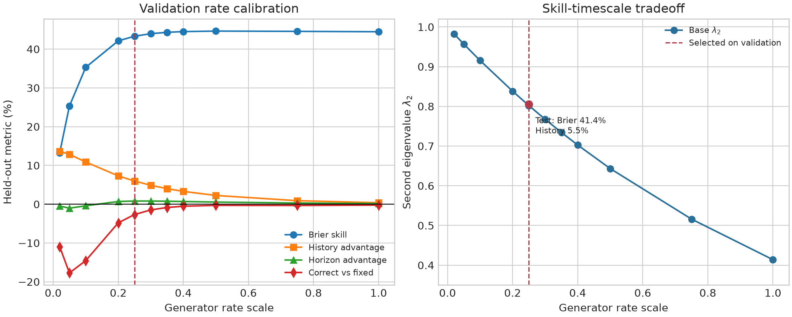
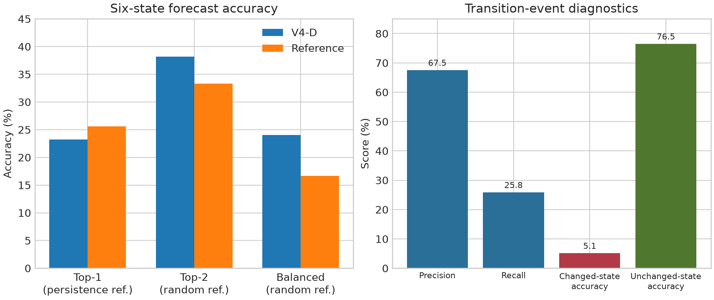

# Protein-JEPA-Frame

Protein-JEPA-Frame is a self-supervised framework for learning protein molecular
dynamics from backbone trajectories. It combines masked latent prediction with
a dynamic-only metastable representation and a reversible continuous-time
transition model.

The current research release is **V4-D**. It is the strongest framework in this
repository for calibrated soft-state dynamics. Earlier checkpoints remain useful
under their original evaluation protocols, so results below are separated by
checkpoint and task rather than combined into one synthetic score.



## V4-D at a glance

V4-D uses a two-stage training protocol on mdCATH:

1. **D1: dynamic representation.** A trajectory-centered, low-pass physical
   state is mapped into six metastable states. Per-trajectory VAMP, switching,
   activity, variance, and identity-leakage controls prevent static
   protein-identity shortcuts.
2. **D2: reversible kinetics.** The D1 representation is frozen. Symmetric
   non-negative fluxes and stationary probabilities parameterize a
   continuous-time generator `Q`; transitions at lag `tau` are
   `P(tau) = exp(tau Q)`.
3. **Validation-only calibration.** The global generator rate is selected on
   the validation split. Scale `0.25` was selected and then locked.
4. **Independent test.** The locked model and scale are evaluated once on the
   trajectory-held-out test split.

This construction satisfies row normalization, detailed balance, and the
semigroup law by design. State assignment does not use MSM labels.

## Results

### Calibrated reversible dynamics

V4-D D2, checkpoint step 250, rate scale `0.25`, independent test set:

| Metric | Result |
| --- | ---: |
| Mean Brier skill vs persistence | **41.37%** |
| History-shuffle advantage | **5.47%** |
| Base transition second eigenvalue | **0.806** |
| Horizon-shuffle advantage | -0.38% |
| Correct horizon vs best fixed depth | -2.60% |

Positive Brier skill means the predicted state probabilities improve over
copying the current state. The positive history-shuffle control shows that part
of this gain depends on trajectory history rather than stationary occupancy
alone.

| Raw-frame horizon | 48 | 64 | 96 | 128 | 192 |
| --- | ---: | ---: | ---: | ---: | ---: |
| Brier skill vs persistence | 39.49% | 40.40% | 42.79% | 44.21% | 39.96% |

### Interpretable six-state forecast metrics



| Metric | V4-D | Reference |
| --- | ---: | ---: |
| Top-1 accuracy | 23.20% | 25.60% persistence |
| Top-2 accuracy | 38.20% | 33.33% random |
| Balanced accuracy | 24.05% | 16.67% random |
| Transition precision | 67.52% | - |
| Transition recall | 25.85% | - |
| Changed-state exact accuracy | 5.11% | 0% persistence by definition |

The main result is a soft-probability improvement, not a hard-classification
win: top-1 accuracy remains 2.4 percentage points below persistence. Full lag
calibration also remains open because horizon-shuffle and fixed-depth controls
are mixed.

### Best established results by protocol

These values come from different models and evaluation protocols.

| Task and checkpoint | Metric | Result |
| --- | --- | ---: |
| Phase-1 multi-lag State-JEPA | VAMP-CV, lag 1, dim 5, normalized | 0.5588 |
| Same checkpoint, later comparable subset | VAMP-CV, lag 1, dim 5, normalized | 0.5757 |
| Phase-1 multi-lag State-JEPA | Trajectory-held-out MSM probe accuracy | 0.5646 |
| V4-A compositional predictor | Mean normalized physical-state MSE skill | 10.10% |
| V4-A compositional predictor | Worst-horizon MSE skill | 8.96% |

See [submission results](docs/submission_rescue_results.md) for the complete
metric interpretation and [Phase-1 summary](docs/phase1_summary.md) for the
original VAMP/MSM protocol.

## Installation

Python 3.10 or newer is required. Install PyTorch for the target CUDA runtime,
then install the package:

```bash
git clone <repository-url>
cd protein_jepa_frame
python -m venv .venv
source .venv/bin/activate
python -m pip install --upgrade pip
python -m pip install -e .
```

For tests and the full probe/plotting stack:

```bash
python -m pip install -e '.[dev,eval]'
```

## Data

Training reads a JSONL manifest with one trajectory per line. Data and
checkpoints are intentionally not committed. Put the mdCATH training manifest
at `manifests/mdcath.train.jsonl`, or update `data.manifest_path` in the YAML
configs.

Minimal NPZ record:

```json
{"npz_path":"/data/trajectory.npz","protein_id":"1abc_A","trajectory_id":"1abc_A_R1","num_frames":10000,"frame_interval_ps":10.0}
```

The NPZ file must contain `coords` with shape `[frames, residues, 4, 3]` in
`N, CA, C, O` order. Optional arrays are `atom_mask`, `residue_mask`, `aatype`,
`residue_index`, `chain_id`, and `time_ps`.

Native mdCATH HDF5 records use `format: "mdcath-hdf5"`, `trajectory_path`,
`domain_id`, and `metadata.hdf5_group`. Absolute trajectory paths inside a
local manifest are supported.

## Train V4-D

The checked-in configs use repository-relative output paths. Commands should be
run from the repository root.

Train D1 from scratch:

```bash
protein-jepa-frame train \
  --config configs/phase4_v4_d1_scratch_dynamic_1k.yaml
```

D2 starts from D1 step 750, freezes the learned representation, and fits the
reversible generator:

```bash
protein-jepa-frame train \
  --config configs/phase4_v4_d2_reversible_kinetics_1k.yaml
```

The research configs run 1,000 optimization steps and checkpoint every 250
steps. They are faithful short-run experiment configs, not tuned production
training recipes.

## Evaluate V4-D

First select a rate only on validation data:

```bash
python scripts/sweep_reversible_rate_scale.py \
  --config configs/phase4_v4_d2_reversible_kinetics_1k.yaml \
  --checkpoint artifacts/phase4_v4_d2_reversible_kinetics_1k/checkpoint_step250.pt \
  --manifest /data/mdcath.validation.jsonl \
  --output artifacts/paper_eval/v4d_rate_sweep_validation.json \
  --scales 0.1 0.2 0.25 0.3 0.4 0.5 \
  --max-batches 50 --batch-size 2 --device cuda:0
```

Then lock the selected scale and evaluate the independent test set:

```bash
python scripts/sweep_reversible_rate_scale.py \
  --config configs/phase4_v4_d2_reversible_kinetics_1k.yaml \
  --checkpoint artifacts/phase4_v4_d2_reversible_kinetics_1k/checkpoint_step250.pt \
  --manifest /data/mdcath.test.jsonl \
  --output artifacts/paper_eval/v4d_test.json \
  --scales 0.25 \
  --max-batches 50 --batch-size 2 --device cuda:0
```

The committed test output is available at
[`docs/results/v4d2_rate_scale_025_test_accuracy.json`](docs/results/v4d2_rate_scale_025_test_accuracy.json).

## Quick verification

```bash
python -m pytest -q
protein-jepa-frame smoke --output-dir artifacts/smoke --steps 5
```

The smoke command uses synthetic trajectories and does not require mdCATH.

## Repository layout

```text
protein_jepa_frame/
  data/                 trajectory loading, paired-window sampling, collation
  models/               geometry encoder, JEPA objectives, reversible generator
  training/             training and checkpoint lifecycle
  eval/                 VAMP, MSM, linear-dynamics, and paper evaluation
configs/                 canonical and ablation experiment configurations
scripts/                 evaluation, calibration, diagnostics, and plotting
tests/                   unit and integration tests
docs/                    designs, iteration log, protocol, and frozen results
```

## Design notes

- [V4-D dynamic-state gate](docs/v4_d_scratch_design.md)
- [V4-D2 reversible kinetics](docs/v4_d2_kinetics_design.md)
- [Evaluation protocol](docs/evaluation_protocol.md)
- [Iteration log](docs/iteration_log.md)
- [Submission-ready results](docs/submission_rescue_results.md)

## Current limitations

- Hard top-1 state accuracy does not yet beat persistence.
- Horizon identity and fixed-depth calibration are not consistently resolved.
- Results depend on the documented mdCATH split and evaluation sampling seed.
- mdCATH data, trained checkpoints, and the broader `artifacts/` directory are
  not part of this repository.
- This repository currently has no declared software license; contact the
  authors before reuse or redistribution.
