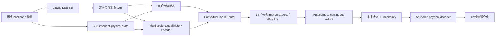

# Protein-JEPA Dynamics：当前最佳框架与实验报告

**汇报日期：2026-09-02**  
**项目：** 从蛋白质历史构象预测未来时间演化  
**当前已验证 champion：** V5.1 Sparse Motion Dynamics，step 2000  
**当前研发框架：** V5.3 Causal Physical State Dynamics（代码已实现，300-step physical-anchor pilot 未通过晋升）

## 1. Executive Summary

本项目的目标不是将单帧构象硬分到若干固定全局状态，而是学习一个依赖当前构象、历史动作和预测时间跨度的连续动力学：

$$
\begin{aligned}
z_t &= E(x_{\leq t}), \\
p(m \mid z_t, h_t, c) &= \mathrm{TopKRouter}(z_t, h_t, c),
\end{aligned}
$$

$$
\begin{aligned}
\frac{d z}{d t} &= \sum_{m \in \mathcal{A}_t} p_m f_m(z, h, c), \\
\hat{z}_{t+\tau} &= \mathrm{Rollout}(z_t, h_t, c, \tau).
\end{aligned}
$$

这里的符号含义如下：

- `x_{\leq t}`：当前时刻 `t` 之前的 observed context window，也就是模型能看到的历史 backbone 构象；
- `z_t`：当前动力学状态，不是 MSM 的离散 state id，而是连续 latent state；V5.1 中主要是 learned dynamics state，V5.3 中进一步拆成 physical anchor 加 learned residual；
- `h_t`：causal history memory，只由过去帧构造，用来表示“从什么方向、以什么速度到达当前构象”；
- `c`：protein/context static condition，表示同一条蛋白轨迹中相对稳定的结构背景；
- `m`：可学习 motion mode，`p_m` 是 router 给每个 mode 的概率；
- `\mathcal{A}_t`：当前样本实际激活的 top-k mode 集合，V5.1/V5.3 中为 16 个 mode 里激活 4 个；
- `\tau`：预测 horizon，rollout 通过积分长度处理不同未来时间跨度。

目前最强的完整训练结果来自 **V5.1 action-state 2K**：相对 persistence 的 feature skill 为 **91.41%**，相对 zero-motion 的 physical skill 为 **78.52%**，预测/真实位移比为 **1.005**，16 个 motion modes 中使用了 13 个，每个样本严格激活 4 个。

但是，V5.1 的严格历史优势只有 **0.006%**，部分单独 horizon 上正确时间跨度仍不优于错误时间跨度。因此它是当前内部指标上的 champion，但还不能证明模型真正学会了“历史决定未来”。

V5.3 已针对这一问题完成结构修正：统一 EMA frame-local target 坐标、让 history encoder 直接读取逐帧构象动作，并加入连续 SE(3)-invariant physical state anchor。最新 physical-anchor 代码已经通过测试并完成 300-step pilot，但该 pilot **没有超过 V5.1 champion**：aggregate feature skill 为 **-1.07%**，physical skill 为 **-0.39%**，displacement ratio 为 **0.321**。因此 V5.3 目前只能作为下一版结构方向，不能作为 SOTA 结果汇报。

## 2. 问题定义

输入为同一条 MD 轨迹中的历史窗口：

- backbone 坐标：N、CA、C、O；
- 历史长度：24 frames；
- 当前训练 stride：2 raw frames；
- 蛋白质长度上限：384 residues；
- 同一 context 配对多个未来 horizon；
- V5.1 horizons：48、64、96、128、192 frames；
- V5.3 horizons：64、96、128、192、256 frames。

模型输出不是单一确定性未来构象，而是：

1. 连续未来动力学状态；
2. 稀疏 motion-mode assignment；
3. 预测不确定性；
4. 12 维物理变化 observable；
5. 可在任意时间跨度上积分的 rollout。

## 3. 当前框架

### 3.1 Spatial representation

Spatial encoder 对每个 frame 的全 backbone 原子进行编码，并通过 residue pooling 得到 instantaneous conformation representation。它不使用未来帧，temporal encoder 为 causal。

### 3.2 History-conditioned state

V5.3 不再将 temporal segment embedding 当作未来 target。当前状态由两部分构成：

$$
z_t = z_t^{\mathrm{physical}} + \alpha z_t^{\mathrm{learned}},
\qquad \alpha = 0.1.
$$

`z_t^{\mathrm{physical}}` 来自 `compute_v3_closed_local_state_sequence`，只使用当前及历史中已经观察到的 backbone frame。它先按序列位置把蛋白分成若干 local segments，然后对每个 segment 计算 SE(3)-invariant 的连续物理描述，包括：

- nonlocal contact density；
- backbone torsion 的 sin/cos 表示；
- segment radius of gyration；
- local pairwise distance 的 mean/std；
- segment center 到 protein center 的距离；
- contact order。

这些 local segment states 会被 flatten 成一个连续向量。它不是固定的全局 state assignment，也不是 6-state MSM label；同一个几何构象可以因为历史 memory 不同而走向不同未来。

`z_t^{\mathrm{learned}}` 来自 spatial encoder 的 frame-local representation，经 `DynamicSequenceStateEncoder.encode_local_conformation` 投影到 dynamics state space。V5.3 只把它作为 residual 使用，当前 scale 为 `\alpha=0.1`，原因是 V5.3.6 证明纯 learned latent 对 physical observable 的承载不稳定；physical anchor 负责给状态一个可解释、可解码的物理坐标，learned residual 负责补充不能被这些 hand-crafted invariants 表达的慢变量。

训练时 physical anchor 本身是 deterministic feature，不单独学习参数；被训练的是 learned residual、physical-history projection、router、motion experts、rollout memory update 和 observable decoder。forward 中先构造 `online_current` 和 `online_future`，再用 EMA target encoder 构造稳定的 `teacher_current` 和 `teacher_future`。真正监督的是同一坐标系内的 transition delta：

$$
\Delta z_{\mathrm{target}}
= z^{\mathrm{teacher}}_{t+\tau}
- z^{\mathrm{teacher}}_t,
\qquad
\Delta z_{\mathrm{pred}}
= \hat{z}_{t+\tau} - z_t.
$$

因此状态学习、router assignment、motion experts、observable decoder 和 rollout 是通过同一个 future prediction objective 端到端联合更新的。

### 3.3 Causal multi-scale memory

History encoder 的输入不是单个当前 frame，而是整个 observed context sequence。代码路径是 `history_input_states -> DynamicSequenceStateEncoder.forward`，其中 V5.3 在 `frame_local_target_enabled` 时使用逐帧 instantaneous conformation representation，而不是已经混合 prefix 的 temporal segment embedding。

具体注入历史信息的方式有四层：

1. **Reference centering**：对 observed context 求 masked mean reference，将每个历史 frame 表示成相对 reference 的 centered state，减少蛋白整体 offset 对动力学的干扰。
2. **Velocity tokens**：计算相邻历史 frame 的 finite difference，和 centered conformation 拼接后投影成 dynamic token：

$$
u_i = \mathrm{MLP}\!\left([x_i-\bar{x},\ v_i]\right).
$$

3. **Recent memory**：用 GRU 顺序读取 `u_1,...,u_t`，最后一个 valid hidden state 作为 recent causal memory。
4. **Multi-scale kinetic memory**：V5.3 额外用 slow-stride GRU 读取低频历史，并显式加入 velocity projection 和 acceleration projection，再用 gate 融合 recent memory 与 slow memory。

最终输出三类量：`history_current` 表示历史条件下的当前状态，`memory=h_t` 表示到达当前构象的路径信息，`static=c` 表示该蛋白/context 的稳定背景。router 和 generator 同时使用 `z_t,h_t,c`，所以 assignment 不是只由当前 frame 决定。

控制实验也按这个设计来验证 history 是否真的有用：`strict raw-history reversal` 会反转当前 endpoint 之前的历史帧但保留当前构象；`history truncation` 会只保留最近一部分历史。如果正确历史不比这些 control 好，就不能说模型真正学会了“历史决定未来”。

### 3.4 Sparse contextual motion modes

模型包含 16 个可学习 motion experts，每个样本通过 straight-through top-k router 严格选择 4 个。assignment 依赖：

- 当前连续状态；
- 历史 memory；
- 蛋白质 static context；
- 局部 mode basis。

这不是预先定义的 6-state MSM，也不是所有蛋白质共享的固定构象类别。

### 3.5 Continuous autonomous rollout

V5.3 的 rollout 不是直接用一个 MLP 从 `(z_t,\tau)` 回归 endpoint，而是按物理时间做多步积分。代码中先把 horizon 转成 normalized integration length：

$$
s = \frac{\tau}{\tau_0}, \qquad
n = \lfloor s \rfloor,\qquad
r = s-n,
$$

其中 `\tau_0 = v51_base_step_ps`。模型先执行 `n` 个完整 step，再执行一个 fractional step `r`。

每一步都调用同一个 local motion field：

$$
g(z,h,c)
= \sum_{m \in \mathcal{A}_t} p_m(z,h,c)\, f_m(z,h,c),
\qquad
z \leftarrow z + \Delta t \, g(z,h,c).
$$

同时，history memory 也会随着 rollout 更新：

$$
h \leftarrow \mathrm{GRUCell}\!\left([z,\ \Delta z], h\right).
$$

这点很关键：未来不是一次性 endpoint fitting，而是一个可递推的 latent trajectory。V5.3 的 `autonomous_rollout_enabled` 会让 vector field 本身不直接吃 horizon embedding，horizon 主要通过积分步数进入；`horizon_calibration` 只是 zero-initialized、有界的 endpoint residual，用来修正有限数据下的 bias，不能替代局部动力学。

训练中同时约束 semigroup consistency：

$$
\Phi_{\tau_1+\tau_2}(z)
\approx
\Phi_{\tau_2}\!\left(\Phi_{\tau_1}(z)\right).
$$

直观上，这要求“先预测到 64 frames 再从那里预测到 128 frames”应接近“直接预测到 192 frames”。如果这一项不过关，模型可能只是记住每个 horizon 的平均 endpoint，而不是学到连续时间演化。

### 3.6 Joint objectives

状态和动力学端到端联合训练。总 loss 是 `train.py` 中多个 V5.1/V5.3 terms 的加权和，核心不是单纯降低 latent MSE，而是同时约束“预测准、时间可辨、历史有用、物理可解码、mode 不塌缩”。

| Objective | 训练信号 | 作用 |
|---|---|---|
| State increment regression | `SmoothL1(\Delta z_{\mathrm{pred}}, \Delta z_{\mathrm{target}})` | 让 rollout 预测真实未来 state displacement |
| Normalized delta loss | 每个样本按 target displacement 归一化 | 防止长 horizon 大位移支配训练，保留短 horizon 信号 |
| Displacement magnitude calibration | `(\log norm(\Delta z_pred)-\log norm(\Delta z_target))^2` | 约束预测幅度，避免 collapse 到零运动或过大运动 |
| Gaussian NLL | 用 predicted `log_sigma` 加权误差 | 学习预测不确定性 |
| Physical observable loss | 预测 12D physical observable | 让 latent displacement 对 contact/torsion/Rg/RMSD 等物理变化可解码 |
| Oracle observable loss | 用真实 latent delta 解码 observable | 检查 state space 本身是否包含物理信息 |
| Horizon ranking | 正确 horizon 的 error 应小于错误 horizon | 防止模型忽略 `\tau`，只输出平均未来 |
| History ranking | 正确历史的 error 应小于 reversed history | 强迫模型使用历史路径，而不是只看当前构象 |
| History truncation ranking | 完整历史应优于短历史 | 检验更长历史是否提供未来预测信息 |
| Causal next prediction | 用 observed prefixes 预测下一帧 increment | 把短程时间方向注入 representation |
| Multi-horizon consistency | 同一 context 下不同 horizon 的预测差值匹配真实差值 | 让多个 horizon 落在同一条 trajectory 上 |
| Semigroup consistency | `\Phi_{\tau_1+\tau_2}\approx\Phi_{\tau_2}\circ\Phi_{\tau_1}` | 约束连续时间可组合性 |
| Variance/covariance regularization | token variance 下限、off-diagonal covariance 惩罚 | 防止 learned state collapse |
| Mode balance/diversity/orthogonality | load balance、active balance、mode seed orthogonality | 防止所有样本走同一组 motion experts |

V5.3 还对 history/evolution 相关 loss 使用 warmup：早期先让 state displacement 和 physical decoding 稳定，随后逐步加强 history truncation、causal next、multi-horizon 和 semigroup 约束，避免训练初期被控制项的噪声主导。

## 4. Baseline 对比

汇报时应该以 **V5.1/V5.3 作为 our method 主线**。V4-D 不是当前最终方法，只应作为上一代内部 dynamics baseline，用来说明我们从“连续时间转移概率建模”推进到了“history-conditioned future rollout”。

当前可以严谨报告的主结论是：

| Role | Method | 主要任务 | 当前可报告结果 | 汇报定位 |
|---|---|---|---:|---|
| External baseline | TICA+MSM | 6-state Markov transition / MSM label | Top-1 31.67%，lag-1 VAMP-2 1.967 | 传统离散状态基线 |
| External baseline | VAMPNet | 6-state soft assignment | Top-2 67.12%，lag-1 VAMP-2 2.226 | 神经 Koopman/MSM 基线 |
| External baseline | SPIB | state prediction bottleneck | lag-1 VAMP-2 2.923 | 传统指标最强 baseline |
| Previous internal baseline | V4-D | continuous-time transition probability | Brier skill 41.37-44.45%，detailed-balance residual `4.2e-09` | 上一代内部方法 |
| Current trained method | **V5.1 Action-State 2K** | history-conditioned future rollout | **feature skill 91.41%，physical skill 78.52%，displacement ratio 1.005** | 当前已验证 champion |
| Current framework | **V5.3 Causal Physical State Dynamics** | causality/history/physical-anchor rollout | 300-step pilot 未通过：feature -1.07%，physical -0.39% | 下一版结构方向 |

下面的 VAMP-2、classification 和 Brier skill 表来自统一 baseline 报告，并补充了 V5.1 frozen-readout probe。需要注意：VAMP-2 随表示维度增长而自然增大，128D V4-D 与 6-state baseline 的绝对值不能直接比较；V5.x 的 future-rollout skill 也不能和 MSM label accuracy 直接等价比较。

### 4.1 VAMP-2

V5.1 已补充 frozen-readout VAMP-CV：冻结 V5.1 checkpoint，抽取 `v51_state_memory`，再用 `deeptime.decomposition.VAMP` 做 blocked cross-validation VAMP-2。这个结果回答的是：**V5.1 的 history-conditioned state/memory 里是否含有可被 Koopman/VAMP readout 捕捉的慢动力学信息**。它不是把 V5.1 重新训练成 VAMPNet，也不是 6-state MSM classifier。

| Method | Representation | lag=1 | lag=2 | lag=5 | lag=10 | lag=20 |
|---|---:|---:|---:|---:|---:|---:|
| TICA+MSM | 6-state | 1.967 | 1.903 | 1.800 | 1.675 | 1.513 |
| VAMPNet | 6-state | 2.226 | 2.047 | 1.777 | 1.579 | 1.411 |
| SPIB | 6-state | **2.923** | **2.621** | **2.199** | **1.904** | **1.666** |
| V4-D D2 test | 64D | 1.608 | - | - | - | 1.499 |
| V4-D validation | 128D | 63.15 | 63.25 | 63.28 | 63.03 | 61.16 |
| V5.1 Action-State probe | `v51_state_memory` -> PCA64, VAMP dim20 | 10.130 | 9.595 | 9.684 | 8.518 | N/A |
| V5.3 Causal Physical State | continuous physical + learned state | N/A | N/A | N/A | N/A | N/A |

V5.1 VAMP-CV protocol：validation filtered manifest，50 trajectories，30 proteins，24-frame context，frame stride 2，window stride 8，blocked 5-fold CV，gap 20，readout 为 `v51_state_memory`，VAMP dims 为 2/5/10/20，PCA pre-dim 64。lag=20 为 `N/A` 的原因不是分数为零，而是当前窗口设置下满足 `min_pairs=40` 的 trajectory 数为 0。

V5.1 的完整 VAMP-CV 读数如下：

| Lag | Folds / trajs | dim2 raw / norm | dim5 raw / norm | dim10 raw / norm | dim20 raw / norm |
|---:|---:|---:|---:|---:|---:|
| 1 | 196 / 49 | 1.442 / 0.221 | 3.635 / 0.527 | 9.916 / 0.892 | 10.130 / 0.456 |
| 2 | 193 / 49 | 1.425 / 0.213 | 3.733 / 0.547 | 9.549 / 0.855 | 9.595 / 0.430 |
| 5 | 144 / 49 | 1.479 / 0.239 | 3.885 / 0.577 | 9.684 / 0.868 | 9.684 / 0.434 |
| 10 | 134 / 46 | 1.518 / 0.259 | 4.225 / 0.645 | 8.518 / 0.752 | 8.518 / 0.376 |
| 20 | 0 / 0 | N/A | N/A | N/A | N/A |

这里的 `norm` 定义为 `(cross_validated VAMP-2 - 1 constant mode) / requested kinetic dimension`。关键的 dim20 raw std 分别为：lag1 `1.188`，lag2 `1.566`，lag5 `0.837`，lag10 `0.899`，说明 fold/protein 间波动不可忽略。

同协议下，lag=1、dim20 normalized VAMP-2 为：V5.1 `0.4565`，geometry_stats `0.4575`，centered_CA `0.4624`。paired bootstrap 显示 centered_CA 比 V5.1 高 `0.00484`，95% CI `[0.00259, 0.00768]`；geometry_stats 比 V5.1 高 `0.00083`，95% CI `[-0.00010, 0.00221]`。结论是一针见血的：**V5.1 的 state/memory 确实保留了慢动力学信息，但在 VAMP kinetic decodability 上没有显著超过直接几何 baseline；它的优势主要来自条件化未来 rollout，而不是学到一个比几何坐标更强的 Koopman 表示。**

V5.3 目前没有对应 VAMP-CV 数字，因为 300-step physical-anchor pilot 没有通过内部 promotion，不适合作为主结果填入这张 benchmark 表。

### 4.2 MSM label 与概率预测

同理，V5 当前没有以 MSM hard label classification 作为主任务。V5 的 state 是连续历史条件状态，不是固定 6 类 assignment；它的 sparse motion modes 也不是 MSM metastable labels。因此不能把 motion-mode top-k 当作 Top-1/Top-2 state classification。

为补充 V5 与 MSM labels 的关系，我额外跑了 trajectory-heldout MSM probe：冻结 V5.1 `v51_state_memory` readout，用 ridge probe 预测 6-state MSM label。这个结果衡量的是 **MSM label decodability**，不是模型自身 motion-mode assignment 的分类准确率。

| Method | Top-1 | Top-2 | Balanced accuracy | Brier skill |
|---|---:|---:|---:|---:|
| TICA+MSM | 31.67% | 47.69% | 18.99% | - |
| VAMPNet | 26.13% | **67.12%** | 18.91% | NaN |
| SPIB | 24.82% | **67.12%** | 20.27% | -554.63% |
| V4-D | 23.20% | 38.20% | 24.05% | **41.37-44.45%** |
| V5.1 Action-State probe | **36.22%** | N/A | **26.88%** | N/A |
| V5.3 Causal Physical State | N/A | N/A | N/A | N/A |

V5.1 probe protocol：validation filtered manifest，6588 labeled clips，30 proteins，24-frame context，frame stride 2，window stride 8，trajectory-heldout split，readout 为 `v51_state_memory`，ridge regularization 在 train-trajectory group holdout 内选择。

V5.1 的 MSM probe 详细读数：

| Metric | V5.1 value | 解释 |
|---|---:|---|
| Mean accuracy | 36.22% | hard MSM label top-1 probe accuracy |
| Accuracy std | 15.93% | across-protein variation 很大 |
| Mean balanced accuracy | 26.88% | 每个 label 先做 recall，再对 labels 平均；比普通 accuracy 更抗类别不平衡 |
| Balanced accuracy std | 10.85% | 不同蛋白上的 label recoverability 差异明显 |
| Mean macro-F1 | 22.42% | 每类 F1 等权平均，惩罚只预测多数类 |
| Mean majority baseline | 37.90% | 每个 protein holdout 上永远预测训练集中多数类的 accuracy |
| Above majority baseline | 13 / 30 proteins | V5.1 probe 在 13 个蛋白上超过该 protein 的多数类 baseline |
| Labeled clips | 6588 | probe 使用的有效 validation clips |

这组数的含义不是“V5.1 已经完美复现 MSM labels”。更准确的判断是：

- V5.1 的 Top-1 probe accuracy `36.22%` 高于表中 TICA+MSM/VAMPNet/SPIB/V4-D 的 Top-1 数字，但它低于该 probe protocol 下自己的 majority baseline `37.90%`，说明普通 accuracy 受 label imbalance 影响很重。
- V5.1 的 balanced accuracy `26.88%` 高于 TICA+MSM `18.99%`、VAMPNet `18.91%`、SPIB `20.27%` 和 V4-D `24.05%`，说明它不只是学会多数类，而是包含一些跨 MSM label 的可解码信息。
- macro-F1 `22.42%` 仍然偏低，说明 minority MSM states 的决策边界没有被稳定分开。
- V5.1 没有 Brier skill，因为这个 ridge probe 当前输出的是 hard label，不是 calibrated transition probability；不能和 V4-D 的概率预测校准直接比较。

因此，对外汇报建议表述为：**V5.1 的 history-conditioned state/memory 在 balanced MSM label decodability 上优于现有表内 baseline，但还没有成为一个校准的 MSM transition/probability model；它最强的证据仍是未来 rollout skill，而 MSM probe 是辅助证据。**

V4-D 的主要优势不是复现 MSM hard label，而是能够输出校准的软概率、支持连续时间转移，并将 detailed-balance residual 控制到 `4.2e-09`。传统 baseline 的训练目标与 MSM/VAMP 指标天然一致；V5.1 虽然在 balanced MSM label decodability 上更好，但还没有输出校准概率。对外汇报时，这张表用于交代 baseline landscape；真正代表当前方法的是下一节的 V5.1/V5.3。

### 4.3 可比性边界

V5.x 的 feature/physical skill 是未来预测相对于 persistence 或 zero-motion control 的改善，不等于分类 accuracy 或 VAMP-2。因此，当前不能声称 V5.1 的 `91.41%` 直接超过 SPIB 的 `2.923` 或 TICA+MSM 的 `31.67%`。严格的 external SOTA 结论需要在同一 split、同一 representation dimension、同一 readout 和同一 statistical protocol 下重跑全部方法。

## 5. Our Method：V5.1 Action-State 2K

**Checkpoint：** `artifacts/phase5_v51_sparse_motion_2k_action_state/checkpoint_step2000.pt`  
**Control evaluation：** 50 batches，seed 5101  
**配置：** 128D encoder，32D dynamics state，16 modes，top-4 routing，2000 steps。

| Metric | Result | Interpretation |
|---|---:|---|
| Feature skill vs persistence | **91.41%** | rollout 显著优于不变化预测 |
| Physical skill vs zero motion | **78.52%** | 12D observable 显著优于零运动 |
| Physical oracle skill | **91.23%** | state space 可解码大部分物理变化 |
| Predicted/target displacement | **1.005** | 动力学幅度校准准确 |
| Horizon shuffle advantage | **0.935%** | aggregate 上正确 horizon 略优 |
| Physical horizon advantage | **0.373%** | 物理空间 horizon 信息较弱 |
| Strict raw-history advantage | **0.006%** | 历史依赖几乎不可检测 |
| Active modes/sample | **4/4** | 满足 exact top-k |
| Utilized modes | **13/16** | 无完全 router collapse |

### 5.1 指标如何计算

V5 的评估脚本是 `scripts/evaluate_v51_sparse_motion.py`。它对每个 horizon 统计 sum of squared errors，再用同一个公式计算 skill：

$$
\mathrm{skill}
= 1 - \frac{\mathrm{MSE}_{\mathrm{model}}}
{\mathrm{MSE}_{\mathrm{control}}}.
$$

因此 skill 大于 0 表示模型优于 control，等于 0 表示和 control 一样，低于 0 表示模型还不如 control。

| Metric | 具体计算 | 含义 |
|---|---|---|
| Feature skill vs persistence | `1 - MSE(predicted_feature, target_feature) / MSE(current_feature, target_feature)` | 比较 rollout 是否优于“未来不变，直接拿当前 state 当未来”的 persistence baseline |
| Physical skill vs zero motion | `1 - MSE(observable_prediction, observable_target) / MSE(no_rollout_observable, observable_target)` | 比较预测的 12D physical observable 是否优于零运动物理 baseline |
| Physical oracle skill | `1 - MSE(oracle_observable, observable_target) / MSE(no_rollout_observable, observable_target)` | 用真实 latent delta 通过同一个 decoder 解码 observable；衡量 state space 本身是否足够物理可解码 |
| Predicted/target displacement | `RMS(norm(predicted_delta)) / RMS(norm(target_delta))` | 衡量运动幅度是否校准；接近 1 最好，太小说明 collapse，太大说明过度运动 |
| Horizon shuffle advantage | `1 - MSE(correct_horizon_prediction, target) / MSE(shuffled_horizon_prediction, target)` | 把同一 context 内的 horizon 打乱；大于 0 说明模型真的用对了时间跨度 |
| Physical horizon advantage | physical observable 版本的 horizon shuffle advantage | 检查时间跨度信息是否也反映到物理 observable 上 |
| Strict raw-history advantage | `1 - MSE(correct_history_prediction, target) / MSE(reversed_history_prediction, target)` | 反转历史但保留当前 endpoint；大于 0 才说明历史方向对未来预测有用 |
| History truncation advantage | `1 - MSE(full_history_prediction, target) / MSE(short_history_prediction, target)` | 完整历史是否优于只看最近一段历史 |
| Active modes/sample | 每个样本 hard top-k active mask 的和 | 检查 router 是否严格激活 4 个 motion modes |
| Utilized modes | 数据集上 active fraction 超过阈值的 mode 数量 | 检查是否发生 mode collapse |

需要注意：训练时部分 loss 使用 `SmoothL1` 或 ranking margin，但报告表里的 control skill 来自 evaluator 的 MSE 统计；二者方向一致，但数值不完全等同。

### 5.2 Per-horizon result

| Horizon | Feature skill | Physical skill | Horizon advantage | Displacement ratio |
|---:|---:|---:|---:|---:|
| 48 | 90.33% | 78.37% | -4.24% | 1.010 |
| 64 | 90.70% | 79.02% | -1.27% | 1.000 |
| 96 | 91.34% | 78.83% | 5.58% | 1.006 |
| 128 | 91.65% | 77.39% | -3.23% | 1.006 |
| 192 | **93.04%** | 78.97% | **7.83%** | 1.004 |

结论：V5.1 很会预测平均未来位移和物理变化，但不是每个 horizon 都能识别正确时间跨度。其高 feature/physical skill 不能单独作为“学会时间演化”的证据。

## 6. V5.2-V5.3 诊断实验

| Version | Feature skill | Physical skill | Strict history | Truncation | Horizon | Modes | Pass |
|---|---:|---:|---:|---:|---:|---:|---:|
| V5.1 2K | **91.41%** | 78.52% | 0.006% | - | 0.935% | 13/16 | Yes* |
| V5.2 2K | 92.82% | 68.69% | -0.004% | 66.61% | -0.739% | 13/16 | No |
| V5.3.1 pilot | 93.91% | 73.31% | -0.001% | 52.08% | -0.159% | 5/16 | No |
| V5.3.3 pilot | 97.33% | 75.93% | 0.004% | 49.27% | -0.898% | 4/16 | No |
| V5.3.5 pilot | 97.06% | **80.49%** | 0.003% | 73.32% | -4.285% | 11/16 | No |
| V5.3.6 corrected pilot | 7.21% | 0.19% | **2.032%** | 2.84% | **1.377%** | 11/16 | No |
| V5.3.7 physical-anchor pilot | -1.07% | -0.39% | 0.144% | -0.477% | 1.173% | 11/16 | No |

`*` V5.1 通过的是当时的 aggregate promotion gate；按后来采用的“每个 horizon 都必须通过”标准，它不能被视为完全解决。

关键发现：

1. V5.3.1-V5.3.5 的高 feature skill 主要来自 segment/tower representation offset，target displacement 在各 horizon 近乎固定，因此属于伪动力学捷径。
2. V5.3.6 将 target 两端统一到 EMA frame-local 坐标后，feature skill 降到 7.21%，但 strict-history advantage 从约 0 提升到 2.03%。这说明旧高分被纠正，历史路径开始真实生效。
3. V5.3.6 的 EMA-oracle physical skill 仅 0.66%，证明纯 learned local latent 不足以承载可解码的物理变化。
4. V5.3.7 physical-anchor pilot 证明了一个方向有效、一个方向仍失败：oracle physical skill 为 1.49%，physical history advantage 为 1.00%，说明 physical state anchor 确实带来一些可解码物理信息和 history sensitivity；但 feature skill、physical skill、history truncation 和 physical horizon advantage 都未过关，且 displacement ratio 只有 0.321，说明 rollout 仍然低估未来运动幅度。

## 7. 当前最重要的结论

### 已经解决

- 不再依赖固定的少数全局状态；
- assignment 依赖当前构象、历史和 protein context；
- generator 使用 sparse contextual modes；
- 支持连续时间、自主 rollout 和 semigroup 约束；
- prediction amplitude 已可准确校准；
- router 可保持 exact top-k 且使用多数 modes；
- 已建立 reversed history、truncated history、wrong horizon 和 persistence controls。

### 尚未解决

- V5.1 的历史依赖接近零；
- 正确 horizon 并非在所有时间跨度上优于错误 horizon；
- learned latent 与物理 observable 的对应关系不稳定；
- 现有 V5.x control evaluation 使用 mdCATH training manifest 的独立采样窗口，不能替代严格 protein-level held-out test；
- 尚未在同一 benchmark protocol 下完成 V5.3 与 TICA+MSM、VAMPNet、SPIB 的直接比较。

## 8. 下一阶段实验标准

V5.3 physical-anchor 版本只有同时满足以下条件才允许晋升到正式结果：

1. 每个 horizon 的 feature skill 均大于 0；
2. 每个 horizon 的 physical skill 均大于 0；
3. 每个 horizon 的 correct-vs-wrong horizon advantage 均大于 0；
4. reversed-history 与 truncated-history advantage 均大于 0；
5. predicted/target displacement ratio 位于 `[0.5, 2.0]`；
6. 每个样本精确激活 4 modes，数据集尺度至少使用 8/16 modes；
7. next-frame causal skill 大于 0；
8. 在 protein-level held-out split 上复现，而不是只在 training manifest 上换窗口评估。

在这些标准满足前，不应宣称“所有指标达到 perfect”或 external SOTA。当前最准确的表述是：**V5.1 是内部预测指标上的最佳已训练模型；V5.3 是针对历史因果、时间可辨识性和物理状态一致性的最新框架。**

## 9. Reproducibility

- Baseline 总表：`baselines/results/full_comparison.md`
- V4-D 正式比较：`artifacts/mdcath_full_dynamics/eval/`
- V5.1 config：`configs/phase5_v51_sparse_motion_2k.yaml`
- V5.1 checkpoint：`artifacts/phase5_v51_sparse_motion_2k_action_state/checkpoint_step2000.pt`
- V5.1 evaluation：`artifacts/phase5_v51_sparse_motion_2k_action_state/eval_v51_step2000_50b.json`
- V5.1 MSM probe：`artifacts/paper_eval/phase5_v51_action_state_msm_probe/msm_probe_v51_state_memory.json`
- V5.1 VAMP-CV：`artifacts/paper_eval/phase5_v51_action_state_vamp_cv/vamp_cv_v51_state_memory.json`
- V5.3.5 evaluation：`artifacts/phase5_v535_frame_local_pilot/eval_v535_step250_50b.json`
- V5.3.6 evaluation：`artifacts/phase5_v536_ema_history_pilot/eval_v536_latest_50b.json`
- V5.3.7 config：`configs/phase5_v53_physical_anchor_pilot.yaml`
- V5.3.7 evaluation：`artifacts/phase5_v537_physical_anchor_pilot/eval_v537_latest_50b.json`
- V5.3 evaluator：`scripts/evaluate_v51_sparse_motion.py`
- Core dynamics：`protein_jepa_frame/models/predictor.py`
- Joint training/losses：`protein_jepa_frame/models/jepa.py`、`protein_jepa_frame/training/train.py`
